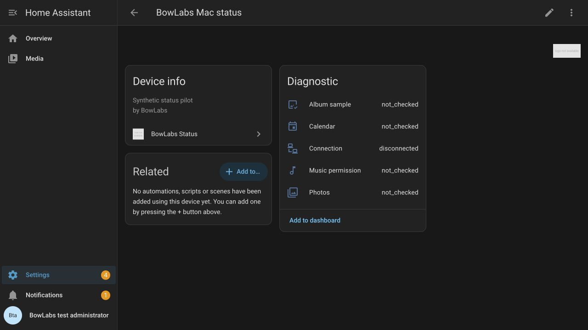

# BowLabs Status — installable synthetic pilot

Version **0.1.0**, tested with Home Assistant **2026.10.2**. This custom integration
receives authenticated, synthetic Mac status reports and exposes five read-only
diagnostic sensors: connection, Photos, Calendar, Music permission, and album sample.
It does not export real Mac module results or control any device or library.

## Installation in an isolated Home Assistant

1. Extract `BowLabs-Home-Assistant-Status-0.1.0.zip` so that the directory is
   `<config>/custom_components/bowlabs_status/` (not a nested duplicate folder).
2. Restart **that isolated Home Assistant instance** to load the new integration.
3. In Settings → Devices & services → Add integration, choose **BowLabs Status**.
   Submit **Enable BowLabs status pairing**. This creates a receiver entry.
4. Start the HTTPS status link in the Mac prototype. Add BowLabs Status again and
   enter the Mac's eight-digit code. After the paired Mac entry has loaded, check
   approval and explicitly approve on the Mac. Neither approval alone permits data.
5. Send a synthetic report from the Mac. The paired device has five real diagnostic
   sensors; no dashboard installation or household entity selection is required.

Mac prototype 0.8 adds explicitly entered HTTPS DNS/IPv4 addresses, macOS trust,
and a per-link pasted public PEM certificate with fingerprint display. Its bundled lab
certificate mode stays restricted to `https://127.0.0.1:18129`. Mac 0.7 remains
loopback-only. Mac 0.8 has been verified using a disposable loopback hostname lab;
no two-computer LAN or household connection is claimed. IPv6 is not yet supported.
The client rejects hostname/date/chain failures and redirects, stores credentials
only in memory, and still sends synthetic reports manually after both approvals.
The integration uses HA's
native HTTPS listener; it opens no new server or port and installs no certificates.
Plain HTTP reporting and browser Origin headers are rejected. Behind a proxy,
HTTPS and HA's trusted-proxy configuration must be correct; do not disable TLS checks.

This package is for isolated testing first. It is not HACS-listed or approved for household installation. The standalone source and CI live in the public `ccabman/bowlabs-status` repository.
The current implementation and instructions are also in this local package.

## Revoke, re-pair, disable, remove

- On the **paired Mac entry**, Configure → `revoke` immediately invalidates its
  credential and clears trusted status. The entry/sensors remain for re-pairing.
- To re-pair, start a new Mac code, then Configure → `pair` on that same entry.
  A still-active previous session must be stopped/revoked first. Confirm on the Mac.
- Removing or disabling the paired entry revokes before sensor unloading. Removal
  also removes its five entities. Re-enabling never restores an old credential.
- Removing or disabling the receiver stops all reporting and invalidates sessions.
  A paired entry left behind shows cleared/revoked status. Re-enable/add the receiver,
  then re-pair the Mac entry; its old credential stays invalid.
- Restarting HA restores entries and sensors with **no trusted results**, but not
  session credentials. Re-pair through Configure. Codes last two minutes and sessions
  ten minutes; session-only credentials are deliberate for this synthetic pilot.
- To uninstall completely, remove both entries, remove only the `bowlabs_status`
  integration directory, and restart the isolated instance. Do not remove BowPane
  or any other integration. Copying/removing code requires a restart; revoking or
  removing entries does not require one.

## Security and privacy

This integration has an independent domain and fixed `status.report.synthetic`
capability. It does not alter BowPane, TV/frame scope, HA user permissions, HA
authentication providers, playback, Photos, calendar events, or Music credentials.
No HA access token is given to the Mac. Only the SHA-256 hash of a random credential
is stored in the HA config entry; no raw credential or report is persisted by the
integration. A stored hash cannot authorize anything after a restart.

Only closed status/permission labels, timestamps, increasing sequences, and bounded
sample counts are accepted. Personal content, album identities, free text, private
errors, credentials, and device commands are rejected. Music permission never means
subscriber/library/playback access. Reports do not establish sync or frame delivery.
HA's recorder may retain the non-personal diagnostic sensor history normally.

The protocol has 4 KiB decoded-body limits, two-second upload deadlines, no compressed
request support, duplicate-key/non-finite/bool-as-integer rejection, five starts per
minute, five code guesses per claim, and 60 reports per minute. HA's own HTTP parser
and global request protections still apply before the view. The integration does
not change HA's global parser, proxy, firewall, or TLS configuration. Invalid requests
do not advance the accepted sequence or update entities. Authorization and receiver
availability are checked again after an upload, so removal during upload fails closed.

After 90 seconds without reports, current results clear to disconnected (checked on
a five-second timer). Removal/unload/revocation clear results immediately. A native
HA administrator is required for setup/options/removal; a read-only HA user cannot
pair or remove entries. There are no integration services, action entities, controls,
outbound HTTP requests, discovery, or third-party Python dependencies.

One receiver and one paired Mac are supported. Persistent unattended credentials,
real-summary export, two-computer LAN verification, production packaging/release
work, and an approved backed-up household pilot remain separate gates.

## Local reproducible verification

From the BowLabs project root, with the existing owned HA environment and test PKI:

```sh
work/mac-lab.nosync/ha/bin/python HomeAssistant/tools/run_lab.py
```

This creates only `work/installable-status.nosync/config`, copies the integration
there before startup, and refuses occupied ports. It runs the real native HA HTTPS
listener on loopback 18129 and adds a test-only HTTP UI site on loopback 18131.
The integration refuses status reports through the HTTP UI site. The fixture uses
normal HA configuration APIs; no `.storage` file is directly read or edited.
No household files or credentials are copied. Stop the foreground fixture with
Control-C. Its synthetic administrator/viewer accounts exist only in this lab.

The UI is <http://127.0.0.1:18131/config/integrations>. Synthetic lab administrator:
`bowlabs-admin` / `bowlabs-isolated-admin`. These are not household credentials.

```sh
python3 -m unittest discover -s HomeAssistant/tests -v
work/mac-lab.nosync/ha/bin/ruff check HomeAssistant --select E,F,I
work/mac-lab.nosync/ha/bin/python HomeAssistant/tools/check_install.py /tmp/bowlabs-status-link-build/build/debug/BowLabsStatusProbe
```

Run the integration test with no installed BowLabs entries. It tests normal admin
flows, real Swift HTTPS reports, five sensors, viewer refusals, re-pair/revoke,
disable/reload, removal during upload, receiver-wide revocation, and clean uninstall.
It deliberately reaches the five-start/minute limit; wait a minute before starting
another pairing run. The ten contract tests inject clocks for expiry/inactivity.

For an actual two-process restart check, run `check_restart.py prepare`, stop/restart
the owned fixture, then run `check_restart.py check`. It proves entries survive but
the old credential and trusted results do not. Raw test credentials stay under the
private lab directory and are never packaged. The optional libturbojpeg warning
does not involve any configured camera.

## Isolated Linux validation



The GitHub Actions workflow runs Linux protocol tests, formatting/lint checks, a real
Home Assistant HTTPS lifecycle test, official hassfest, and the full HACS action
with no ignored checks. The runtime test creates temporary configuration and a
one-day test certificate, binds only loopback, uses synthetic reports, and deletes
the sandbox on exit. No household credentials or Mac libraries are supplied to CI.

Run the same runtime test with `python tools/check_linux.py` in an environment with
Home Assistant 2026.10.2. This validates Linux HA behavior; the native Swift sender
remains covered by the separate Mac lab tests. Passing CI does not publish to HACS
or authorize household installation.
